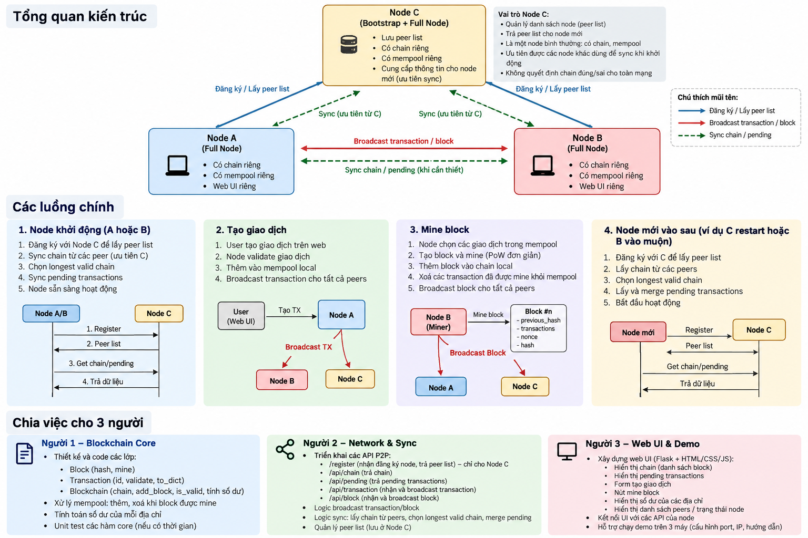
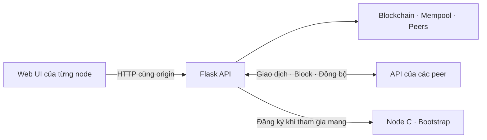

# Chainroom — Blockchain Network & Web UI

## Đề tài và nhóm tác giả

**Đề tài:** Demo blockchain và ứng dụng cơ bản bằng Python.

**Nhóm thực hiện:** `g3n_71nh_h04`

| STT | Họ và tên | Mã sinh viên |
| --- | --- | --- |
| 1 | Hoàng Hải Đăng | B24DCAT038 |
| 2 | Đinh Văn Đức | B24DCAT059 |
| 3 | Trần Duy Tân | B24DCAT246 |

## Tổng quan

Chainroom là dự án blockchain bài tập nhóm của môn lập trìnnh Python (INT13162), gồm lõi xử lý giao dịch và block, mạng các node trao đổi dữ liệu qua HTTP, và giao diện web theo dõi hoạt động của từng node. Hệ thống triển khai theo thuật toán Proof of Work, truyền giao dịch và block giữa các peer, đồng bộ chuỗi và nhận diện trạng thái kết nối peer.

Mạng mặc định gồm sáu node **A, B, C, D, E và F**. Mỗi node quản lý blockchain, danh sách giao dịch chờ và danh sách peer riêng trong bộ nhớ. Node C đóng vai trò bootstrap, hỗ trợ các node khác tham gia mạng và khám phá peer.



## Chức năng

| Thành phần | Chức năng |
| --- | --- |
| Blockchain | Tạo genesis block cấp sẵn 1000 coin cho A/B/C/D/E/F, liên kết block bằng SHA-256, kiểm tra hash và Proof of Work |
| Giao dịch | Tiếp nhận giao dịch, tạo ID và thời gian, quản lý mempool, kiểm tra trùng ID ở lớp mạng |
| Số dư | Tra cứu số dư đã xác nhận, tiền chờ gửi/nhận và tiền khả dụng theo địa chỉ |
| Mining | Đóng gói giao dịch chờ vào block, tìm nonce phù hợp và tạo giao dịch thưởng |
| Mạng | Đăng ký node, cập nhật peer, truyền giao dịch và block qua HTTP |
| Đồng bộ | Chọn chuỗi dài hơn, cùng genesis và vượt qua kiểm tra tính hợp lệ của core; cập nhật mempool |
| Nhận diện peer | Đọc tên, vai trò, khả năng phản hồi, độ trễ và thời điểm kiểm tra |
| Web UI | Dashboard, Số dư, Blockchain, Transactions, Mempool, Mining và Network |

## Công nghệ

- **Python**: xử lý blockchain, mạng và các bộ chạy kiểm thử; môi trường dự án đang dùng Python 3.12.
- **Flask `>=3.1,<4`**: cung cấp API HTTP và phục vụ Web UI.
- **HTML, CSS, JavaScript ES modules**: giao diện web thuần.
- **Thư viện chuẩn Python**: SHA-256, JSON, UUID, HTTP client và xử lý đồng thời khi kiểm tra peer.

## Cấu trúc thư mục

```text
ProjectPython/
├── README.md                     # Hướng dẫn toàn dự án
├── Overview.png
├── Blockchain Core/              # Lõi blockchain dùng chung
│   ├── core_sys.py                # Transaction, Block, Blockchain
│   └── Host.py                    # Launcher node C, dùng API từ network.py
├── Network & Sync/               # API, mạng và đồng bộ
│   ├── network.py                 # API, peer, broadcast và đồng bộ
│   └── run_node.py                # Chạy node A-F chỉ với API
└── Web UI/
    ├── README.md                 # Hướng dẫn chi tiết giao diện
    ├── requirements.txt          # Dependency Python
    ├── run_web_node.py           # Chạy backend và Web UI cùng node
    ├── web/
    │   ├── index.html
    │   └── static/
    │       ├── css/style.css
    │       └── js/               # Views, API adapters, chuẩn hóa dữ liệu và cấu hình
    ├── tests/                    # Kiểm thử API, giao diện và tích hợp
    └── docs/                     # Tài liệu thiết kế, kiểm tra và các mốc phát triển
```

`Web UI/run_web_node.py` dùng trực tiếp `create_app` và các hàm mạng trong `Network & Sync/network.py`, sau đó bổ sung đường dẫn `/ui/` và tài nguyên tĩnh. `network.py` import các lớp từ `Blockchain Core/core_sys.py`, sử dụng đường dẫn theo vị trí file để chạy được từ các thư mục khác nhau.

Toàn dự án chỉ có một `core_sys.py` tại `Blockchain Core/`. Đây là bản core đang dùng trước đây ở `Network & Sync/`, đã được chuyển nguyên nội dung và thay thế bản core/API cũ. API Flask nằm trong `network.py`; `Host.py` cũng dùng `create_app` từ module này để chạy node C. Muốn chạy node A/B chỉ với API, dùng `Network & Sync/run_node.py A` hoặc `B`; muốn có Web UI, dùng launcher bên dưới.

## Kiến trúc hoạt động



| Node | Vai trò | Cổng | Web UI |
| --- | --- | --- | --- |
| C | Bootstrap và xử lý blockchain | 5000 | <http://127.0.0.1:5000/ui/> |
| A | Xử lý blockchain | 5001 | <http://127.0.0.1:5001/ui/> |
| B | Xử lý blockchain | 5002 | <http://127.0.0.1:5002/ui/> |
| D | Xử lý blockchain | 5003 | <http://127.0.0.1:5003/ui/> |
| E | Xử lý blockchain | 5004 | <http://127.0.0.1:5004/ui/> |
| F | Xử lý blockchain | 5005 | <http://127.0.0.1:5005/ui/> |

Node C cũng lưu chuỗi và có thể xử lý giao dịch, mining như các node khác. Mỗi node kiểm tra chuỗi nhận được bằng core của mình; vai trò bootstrap không cấp quyền quyết định chuỗi cho toàn mạng.

## Cài đặt và chạy

Các lệnh dưới đây dùng **PowerShell**, chạy từ thư mục gốc dự án.

### 1. Chuẩn bị môi trường Python

```powershell
py -3.12 -m venv "Web UI/.venv"
& "Web UI/.venv/Scripts/python.exe" -m pip install -r "Web UI/requirements.txt"
```

Nếu đã có môi trường `Web UI/.venv` hoạt động, bỏ qua bước tạo lại. Nếu máy không có lệnh `py`, dùng `python -m venv "Web UI/.venv"` với bản Python đã cài. Các lệnh chạy bên dưới gọi trực tiếp Python trong môi trường ảo, không cần kích hoạt môi trường bằng `Activate.ps1`.

### 2. Khởi động các node cùng Web UI

Mở ba terminal tại thư mục gốc. Chạy **C trước**, chờ server sẵn sàng rồi chạy **A**, sau đó **B**.

```powershell
# Terminal 1 — Node C
& "Web UI/.venv/Scripts/python.exe" "Web UI/run_web_node.py" C
```

```powershell
# Terminal 2 — Node A
& "Web UI/.venv/Scripts/python.exe" "Web UI/run_web_node.py" A
```

```powershell
# Terminal 3 — Node B
& "Web UI/.venv/Scripts/python.exe" "Web UI/run_web_node.py" B
```

Mở một trong các địa chỉ Web UI ở bảng trên. Đường dẫn `/` tự chuyển đến `/ui/`. API và giao diện chạy cùng Flask server nên cấu hình mặc định không cần CORS hoặc proxy.

Launcher Web UI lắng nghe trên `127.0.0.1`. Cấu hình đăng ký và khôi phục peer hiện dùng địa chỉ loopback, phù hợp chạy các node trên cùng máy. Có thể khởi động thêm D, E, F bằng cùng lệnh với tên node tương ứng.

### 3. Sử dụng giao diện

1. **Dashboard**: xem tên node, số block, chiều cao chuỗi, số giao dịch chờ và block mới nhất.
2. **Transactions**: nhập người gửi, người nhận và số lượng lớn hơn 0 để gửi giao dịch vào node hiện tại.
3. **Mempool**: xem giao dịch chờ; mở node khác và làm mới để kiểm tra kết quả truyền giao dịch.
4. **Mining**: nhập địa chỉ nhận thưởng, tạo block rồi xem kết quả hash, nonce và giao dịch.
5. **Blockchain**: duyệt danh sách block, mở chi tiết và sao chép hash.
6. **Network**: xem peer đã đăng ký, danh tính và trạng thái phản hồi; bấm **Làm mới** để kiểm tra lại.

Dashboard và Blockchain hỗ trợ tự động làm mới theo khoảng thời gian được chọn. Dữ liệu trên mỗi trang thuộc node đang mở; trạng thái peer phản ánh lần kiểm tra gần nhất.

### Dừng hệ thống

Nhấn `Ctrl+C` tại từng terminal. Dữ liệu nằm trong RAM: node khởi động lại có thể lấy lại dữ liệu từ các peer còn chạy thông qua quy trình đồng bộ. Khi dừng toàn bộ node, dữ liệu giao dịch và chuỗi đã tạo không được lưu cho lần chạy sau.

## Luồng xử lý blockchain

**Giao dịch:** node tiếp nhận yêu cầu, tạo ID và timestamp nếu chưa có, kiểm tra dữ liệu cơ bản rồi thêm vào mempool. Lớp mạng kiểm tra ID trùng trong mempool và chuỗi, đồng thời gửi giao dịch mới đến các peer. Header `X-From-Peer: 1` ngăn việc phát lại giao dịch vừa nhận từ peer.

**Mining:** node gom các giao dịch đang chờ vào block, tăng nonce cho đến khi hash đáp ứng độ khó rồi thêm block vào chuỗi. Độ khó mặc định là **2**, tức hash bắt đầu bằng `00`. Block mới được gửi tới các peer để kiểm tra và tiếp nhận.

**Phần thưởng:** khi mining, node đặt một giao dịch coinbase `SYSTEM → node` với số lượng mặc định **100** ở đầu block mới. Node chỉ được nhận thưởng vào chính địa chỉ của mình; tổng giá trị giao dịch chờ trong block phải lớn hơn 100, nên không thể mine block rỗng để nhận thưởng.

**Đồng bộ:** khi tham gia mạng, node tải chuỗi và pending từ các peer. Node chỉ thay chuỗi khi tìm được chuỗi dài hơn, cùng genesis và vượt qua các kiểm tra hash, liên kết và Proof of Work của core. Khi nhận block không nối được vào đầu chuỗi hiện tại, node cũng thử đồng bộ. Cơ chế hiện tại không có lịch đồng bộ chuỗi định kỳ và không chọn lại chuỗi khi hai chuỗi dài bằng nhau.

**Khôi phục bootstrap:** khi khởi động, C kiểm tra A/B tại các cổng đã cấu hình để thu thập peer và đồng bộ lại dữ liệu nếu còn node hoạt động.

## API của backend tích hợp

Base URL là địa chỉ node, ví dụ `http://127.0.0.1:5001`. Yêu cầu có body dùng JSON với `Content-Type: application/json`.

| Phương thức | Đường dẫn | Chức năng / dữ liệu chính |
| --- | --- | --- |
| GET | `/api/node` | Danh tính node: `{ node, role }` |
| GET | `/api/chain` | Chuỗi hiện tại: `{ node, length, chain }` |
| GET | `/api/pending` | Mempool: `{ count, pending }` |
| GET | `/api/balance?address=Miner-A` | Số dư: `{ confirmed_balance, pending_outgoing, pending_incoming, available_balance }` |
| POST | `/api/transaction` | Nhận giao dịch: `{ sender, receiver, amount }`; request trực tiếp chỉ được gửi từ địa chỉ của node hiện tại và phải đủ số dư khả dụng |
| POST | `/api/mine` | Mine block: `{ miner_address }`; địa chỉ phải trùng node hiện tại |
| POST | `/api/block` | Nhận block từ peer: `{ previous_hash, timestamp, transactions, nonce, hash }` |
| GET | `/api/peers` | Danh sách địa chỉ: `{ node, peers: [address, ...] }` |
| GET | `/api/peers/details` | Danh tính và trạng thái phản hồi của từng peer |
| POST | `/api/peer` | Thêm địa chỉ peer: `{ address }` |
| POST | `/register` | Đăng ký node với bootstrap: `{ address }`; chỉ có ở C |

Giao dịch mới và block vừa mine trả HTTP `201`. Giao dịch trùng ID trả `200` với thông báo, không tạo giao dịch mới. Giao dịch không hợp lệ theo kiểm tra core trả `400`; block không phù hợp sau bước đồng bộ trả `409`.

Ví dụ gửi giao dịch và mine tại A:

```powershell
Invoke-RestMethod -Method Post -Uri "http://127.0.0.1:5001/api/transaction" `
    -ContentType "application/json" `
    -Body '{"sender":"A","receiver":"Bob","amount":10}'

Invoke-RestMethod -Method Post -Uri "http://127.0.0.1:5001/api/mine" `
    -ContentType "application/json" `
    -Body '{"miner_address":"A"}'

Invoke-RestMethod -Uri "http://127.0.0.1:5001/api/peers/details"
```

### Nhận diện peer

`/api/peers/details` gọi `/api/node` của các địa chỉ đã đăng ký, với tối đa 8 kết nối song song và timeout socket 2 giây cho mỗi peer. Kết quả gồm:

```json
{
  "node": "A",
  "peers": [
    {
      "address": "http://127.0.0.1:5000",
      "node": "C",
      "role": "bootstrap",
      "status": "online",
      "latency_ms": 4.2,
      "checked_at": "2026-10-17T01:00:00+00:00"
    }
  ]
}
```

Vai trò là `bootstrap` hoặc `full`. Trạng thái là `online` khi API nhận diện trả dữ liệu hợp lệ, `unreachable` khi gặp lỗi kết nối/HTTP/timeout, hoặc `invalid_response` khi địa chỉ hay dữ liệu không hợp lệ. Nếu không nhận diện được, các trường `node`, `role`, `latency_ms` là `null`; kết quả của các peer khác vẫn được trả về.

Tên và vai trò do peer tự khai báo. Kết quả kiểm tra phản hồi không xác nhận danh tính bằng mật mã hoặc chứng minh các node đã đồng bộ blockchain.

## Cấu hình giao diện

Cấu hình nằm tại [Web UI/web/static/js/config.js](Web%20UI/web/static/js/config.js).

| Khóa | Mặc định | Ý nghĩa |
| --- | --- | --- |
| `MODE` | `mock` khi phục vụ file tĩnh | Chọn nguồn dữ liệu; launcher Flask luôn ép `real` |
| `API_BASE_URL` | Chuỗi rỗng | Gọi API cùng origin với giao diện |
| `REQUEST_TIMEOUT_MS` | `10000` | Thời gian chờ API, gồm đọc response body |
| `REFRESH_INTERVAL_MS` | `0` | Tắt tự làm mới; giá trị dương bật cho Dashboard/Blockchain |
| `MOCK_SCENARIO` | `success` | Kịch bản kiểm thử: `success`, `empty`, `error`, `offline` |
| `MOCK_DELAY_MS` | `300` | Độ trễ của dữ liệu mô phỏng |

Chế độ mô phỏng phục vụ phát triển giao diện độc lập:

```powershell
& "Web UI/.venv/Scripts/python.exe" -m http.server 8080 --bind 127.0.0.1 --directory "Web UI/web"
```

Mở <http://127.0.0.1:8080/>. Khi chạy qua `run_web_node.py`, giao diện luôn dùng backend thật, kể cả URL có `?mode=mock`. Khi API thật gặp lỗi, giao diện hiển thị lỗi thay vì chuyển sang dữ liệu mô phỏng.

## Kiểm thử

Chạy các lệnh từ thư mục gốc, sau khi cài dependency:

```powershell
# API nhận diện peer: node riêng trên cổng tạm, không dùng cổng 5000–5002
& "Web UI/.venv/Scripts/python.exe" "Web UI/tests/test_peer_api.py"

# Giao diện và API adapter: Edge headless, dữ liệu kiểm thử riêng
& "Web UI/.venv/Scripts/python.exe" "Web UI/tests/run_checks.py"

# Tích hợp backend thật và giao diện: cần cổng 5000–5002 trống
& "Web UI/.venv/Scripts/python.exe" "Web UI/tests/run_live_checks.py"
```

Bộ kiểm tra peer có **7 bài**, kiểm tra danh tính, vai trò, peer ngừng phản hồi, timeout, dữ liệu sai và khả năng tương thích API cũ. Bộ kiểm tra giao diện có **79 kiểm tra**, bao gồm adapter, các trang chức năng, form, hiển thị peer và bố cục ở nhiều kích thước màn hình.

Hai bộ kiểm tra có trình duyệt mặc định dùng Microsoft Edge trên Windows. Có thể đặt biến môi trường `BROWSER_PATH` đến trình duyệt Chromium khác. Runner tích hợp tạo ba node RAM riêng, kiểm tra truyền giao dịch/block, tham gia mạng và đồng bộ; các server kiểm thử được đóng khi kết thúc. Dừng các node đang chạy trước khi dùng runner này; việc dừng toàn bộ node sẽ làm mất dữ liệu RAM của phiên hiện tại.

## Phạm vi hiện tại

- Blockchain, mempool và peer list được lưu trong RAM, chưa có cơ sở dữ liệu hoặc lưu trạng thái xuống đĩa.
- Core và API hỗ trợ tra cứu tiền khả dụng, nhưng chưa chặn giao dịch vượt quá số dư.
- Chưa có ví, chữ ký số hay xác thực người gửi; địa chỉ trong giao dịch là chuỗi văn bản.
- Đồng bộ dùng độ dài chuỗi cùng các kiểm tra của core, chưa triển khai lựa chọn theo tổng công việc tích lũy hoặc xử lý đầy đủ các tình huống đồng thuận.
- Broadcast gửi lần lượt đến các peer với timeout 3 giây mỗi peer. Thành công tại một node không bảo đảm tất cả peer đã nhận dữ liệu.
- Cấu hình mạng mặc định dành cho ba node trên cùng máy; chạy trên nhiều máy cần điều chỉnh địa chỉ đăng ký, bootstrap và khôi phục peer.

## Xử lý sự cố thường gặp

| Hiện tượng | Cách kiểm tra |
| --- | --- |
| A/B không khởi động được do lỗi kết nối | Chạy C trước và chờ API trên cổng 5000 sẵn sàng |
| Cổng đã được sử dụng | Kiểm tra có launcher khác đang chạy cùng node; mỗi cổng chỉ dùng một tiến trình |
| `/ui/` trả 404 | Dùng `Web UI/run_web_node.py` thay cho launcher chỉ API |
| Peer chưa có tên hoặc không phản hồi | Khởi động lại peer với mã mới, kiểm tra `/api/node`, rồi làm mới Network |
| Giao diện dùng dữ liệu mô phỏng | Mở địa chỉ `/ui/` của Flask; server file tĩnh ở cổng 8080 mặc định dùng mock |
| POST timeout hoặc mất kết nối | Kiểm tra chain/mempool trước khi gửi lại vì node có thể đã xử lý yêu cầu |
| Không thấy reward trong mempool sau mining | Bình thường: coinbase nằm ở đầu block vừa đào, không nằm trong mempool |
| Bộ kiểm tra giao diện không tìm thấy trình duyệt | Kiểm tra cài đặt Edge hoặc đặt `BROWSER_PATH` |
